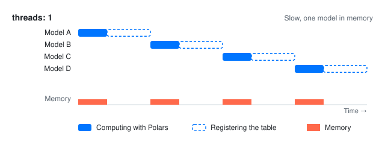
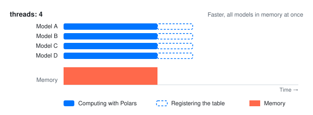
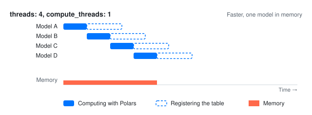

---
mdx:
  format: mdx
---

# Performance

Polars is built to process large amounts of data efficiently. This page collects best practices to get the most out of that efficiency in dbt-polars, while keeping memory use low.

## Writing efficient models

Polars is fastest when it can see the whole query of a model before it runs it. The practices below help Polars get there.

### Lazy and eager execution

Polars supports [two modes of operation: lazy and eager](https://docs.pola.rs/user-guide/concepts/lazy-api/). Eager mode runs each transformation immediately on a DataFrame in memory. Lazy mode builds a query plan on a LazyFrame, and [optimizes](https://docs.pola.rs/user-guide/lazy/optimizations/) and runs it as a whole when the result is needed.

SQL models always run lazily. In Python models, `dbt.ref` returns a LazyFrame, and calling `collect()` switches to eager mode. Where possible, keep models lazy, and return a LazyFrame.

A common example is logging the number of rows of a model. Calling `collect()` for this loads the full result in memory:

<div className="row">
<div className="col col--6">

**Avoid**

```python
def model(dbt, session) -> pl.DataFrame:
    orders: pl.LazyFrame = dbt.ref("orders")
    paid = orders.filter(
        pl.col("status") == "paid"
    ).collect()

    print(f"{paid.height} paid orders")

    return paid
```

</div>
<div className="col col--6">

**Prefer**

```python
def model(dbt, session) -> pl.LazyFrame:
    orders: pl.LazyFrame = dbt.ref("orders")
    paid = orders.filter(
        pl.col("status") == "paid"
    )

    count = paid.select(pl.len()).collect()
    print(f"{count.item()} paid orders")

    return paid
```

</div>
</div>

The first model loads all paid orders in memory just to count them, and returns them as a DataFrame. The second only counts the rows in a small separate query, and returns the paid orders as a LazyFrame, which Polars can still optimize and stream to storage.

### Write models that can be streamed

When dbt-polars writes a table, Polars [streams](https://docs.pola.rs/user-guide/concepts/streaming/) the result of a lazy model to storage in batches, so the full table is never in memory at once. Some operations need to see all rows before they can produce any output, so Polars has to hold all data in memory for them. A common example of a non-streamable operation is sorting:

<div className="row">
<div className="col col--6">

**Avoid**

```python
def model(dbt, session) -> pl.LazyFrame:
    orders: pl.LazyFrame = dbt.ref("orders")

    return orders.sort("order_date")
```

</div>
<div className="col col--6">

**Prefer**

```python
def model(dbt, session) -> pl.LazyFrame:
    orders: pl.LazyFrame = dbt.ref("orders")

    return orders
```

</div>
</div>

### Compute values inside the query

When a model needs a value from the data, such as an average, compute it in the same query as the rest of the model. Polars can then optimize the model as one query:

<div className="row">
<div className="col col--6">

**Avoid**

```python
def model(dbt, session) -> pl.LazyFrame:
    orders: pl.LazyFrame = dbt.ref("orders")
    average = (
        orders
        .select(pl.col("amount").mean())
        .collect()
        .item()
    )

    return orders.filter(
        pl.col("amount") > average
    )
```

</div>
<div className="col col--6">

**Prefer**

```python
def model(dbt, session) -> pl.LazyFrame:
    orders: pl.LazyFrame = dbt.ref("orders")

    return orders.filter(
        pl.col("amount")
        > pl.col("amount").mean()
    )
```

</div>
</div>

Both models keep the orders above the average amount. The first runs a separate query for the average, which only reads the amount column, and then a second query for the result. It reads the amount column twice, once for the average and once for the result. The second model computes everything in one query.

### Use Polars expressions instead of Python functions

A Python function, such as a lambda in `map_elements`, runs once per row in Python. Polars can't look inside it to optimize the query, and it is much slower than a Polars expression, which runs in Polars' own engine.

<div className="row">
<div className="col col--6">

**Avoid**

```python
orders.with_columns(
    pl.col("amount").map_elements(
        lambda amount: amount * 1.21,
        return_dtype=pl.Float64,
    )
)
```

</div>
<div className="col col--6">

**Prefer**

```python
orders.with_columns(
    pl.col("amount") * 1.21
)
```

</div>
</div>

### Use ephemeral models for intermediate steps

A table is written to storage and read back by every model that references it. An [ephemeral model](python-models.md#ephemeral-models) becomes part of the query of the models that reference it, so Polars can optimize them together.

<div className="row">
<div className="col col--6">

**Avoid**

```python
def model(dbt, session) -> pl.LazyFrame:
    dbt.config(materialized="table")

    orders = dbt.ref("orders")

    return orders.filter(
        pl.col("status") == "paid"
    )
```

</div>
<div className="col col--6">

**Prefer**

```python
def model(dbt, session) -> pl.LazyFrame:
    dbt.config(materialized="ephemeral")

    orders = dbt.ref("orders")

    return orders.filter(
        pl.col("status") == "paid"
    )
```

</div>
</div>

Keep a table for results that you query outside dbt, or that many models reuse.

## Running models in parallel

In dbt, the [threads](https://docs.getdbt.com/docs/running-a-dbt-project/using-threads) parameter lets you run several models at the same time. Most dbt adapters send each model to a warehouse, so more threads make a run faster. In dbt-polars, models all run on the same node, where Polars can already use multiple CPU cores for a single model. More threads then often don't make the computation faster, but do increase memory use.

The diagrams below show four models. Each model first computes with Polars, and then registers its table in the catalog. With `threads: 1`, each model waits until the previous one has registered its table. Only one model is in memory at a time, but the run is slow:



With `threads: 4`, all models compute at the same time. They share the same CPU cores, so each model computes slower, and all of them hold their data in memory at once:



Registering a table in the catalog can take time, but uses little CPU and memory. To use that time without running all models at once, set `compute_threads`. It limits how many of the running models compute with Polars at the same time:

```yaml
my_project:
  target: dev
  outputs:
    dev:
      type: polars
      threads: 4           # models dbt runs at the same time
      compute_threads: 1   # of which compute with Polars at the same time
      ...
```



The models compute one after another, while they register their tables at the same time. With `compute_threads: 1` you keep memory usage under control as only one model is in memory, while at the same time making the run execute faster by parallellizing metadata operations.

:::tip
Keep `compute_threads: 1`, but increase `threads` on catalogs where metadata operations account for a large portion of the execution time.
:::

## Writing Iceberg tables in batches

dbt-polars writes Iceberg tables in batches of rows. Polars computes one batch at a time, and dbt-polars writes it as data files, so only one batch is in memory at a time. Set the size of a batch, in rows, with `batch_size` in the `write_options` of a model:

```sql
{{ config(materialized="table", write_options={"batch_size": 1000000}) }}
```

The default is 50,000,000 rows. A smaller batch size lowers the memory use of a model, but writes more and smaller data files. Batches only apply to lazy results. A Python model that returns a DataFrame already holds all its data in memory.

## Read more

* [Python models](python-models.md): LazyFrames and ephemeral Python models.
* [Lazy API](https://docs.pola.rs/user-guide/concepts/lazy-api/): how lazy queries work in Polars.
