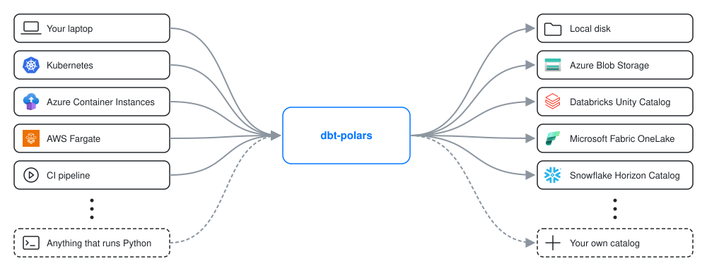
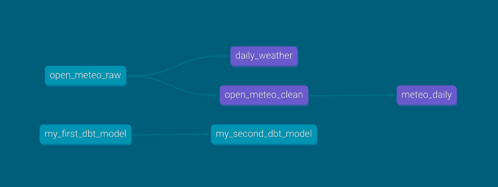

# dbt-polars

dbt-polars integrates the flexibility and performance of Polars with the data governance and lineage capabilities of dbt.

<div className="alert alert--info margin-bottom--md" role="note">dbt-polars is an independent project. It is not affiliated with, endorsed by, or maintained by the Polars team or dbt Labs.</div>

## Python and SQL, side by side

Choose Python or SQL per model, whichever fits the transformation best. Both run on the same Polars engine and can freely reference each other. Unlike in dbt-core, Python models are first class and can do anything a SQL model can.

<div className="row">
<div className="col col--6">

```python
# models/daily_weather.py
import polars as pl


def model(dbt, session) -> pl.LazyFrame:
    hourly = dbt.ref("open_meteo_raw")
    return hourly.group_by("date").agg(
        pl.col("temperature_2m").min().alias("min_temperature"),
        pl.col("temperature_2m").max().alias("max_temperature"),
    )
```

</div>
<div className="col col--6">

```sql
-- models/daily_weather.sql
select
    date,
    min(temperature_2m) as min_temperature,
    max(temperature_2m) as max_temperature
from {{ ref('open_meteo_raw') }}
group by date
```

</div>
</div>

## The flexibility of Python and Polars



### Run anywhere

Polars executes your models in the same process as dbt. You don't need an expensive data warehouse to run your transformations. dbt-polars runs anywhere you can run Python.

### Store data where you want

dbt-polars connects to popular platforms such as Databricks, Snowflake and Microsoft Fabric. Setting one up only takes a few lines in your profile. See [Connecting to a catalog](guides/connecting-to-a-catalog.md) for the full list.

### Extensible to any platform

Implement a custom catalog to tailor dbt-polars to your platform. A custom catalog controls authentication, where data is written and how metadata is registered. The dbt-polars engine still performs the writes. See [Custom catalogs](guides/custom-catalog.md) to build your own.

## The familiarity of dbt

If you know dbt, you already know how to use dbt-polars.  Introduce dbt-polars to your Python projects to benefit from key dbt-features, such as lineage and documentation.
See [dbt compatibility](dbt-compatibility.md) for the full list of supported dbt features.




## Built for efficiency

dbt-polars builds on the full power of the Polars engine. Models run lazily, so Polars optimizes the whole query before running it. Execution and writes are streamed in batches to keep memory use low. See [Performance](guides/performance.md) for tips on writing efficient models.

## Where to next

* [Quick start](quickstart.md): run your first dbt-polars project in a few minutes.
* [Demo project](tutorial/loading-data.md): a guided tutorial in which you set up a weather data processing pipeline and use many of dbt-polars' features along the way.
* [Essentials](guides/connecting-to-a-catalog.md): a good starting point for using dbt-polars in your own projects, starting with connecting to a catalog.
